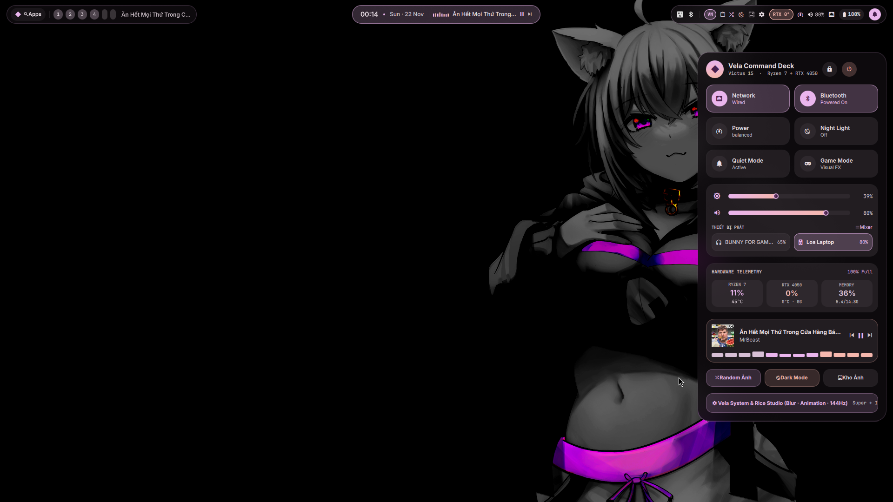
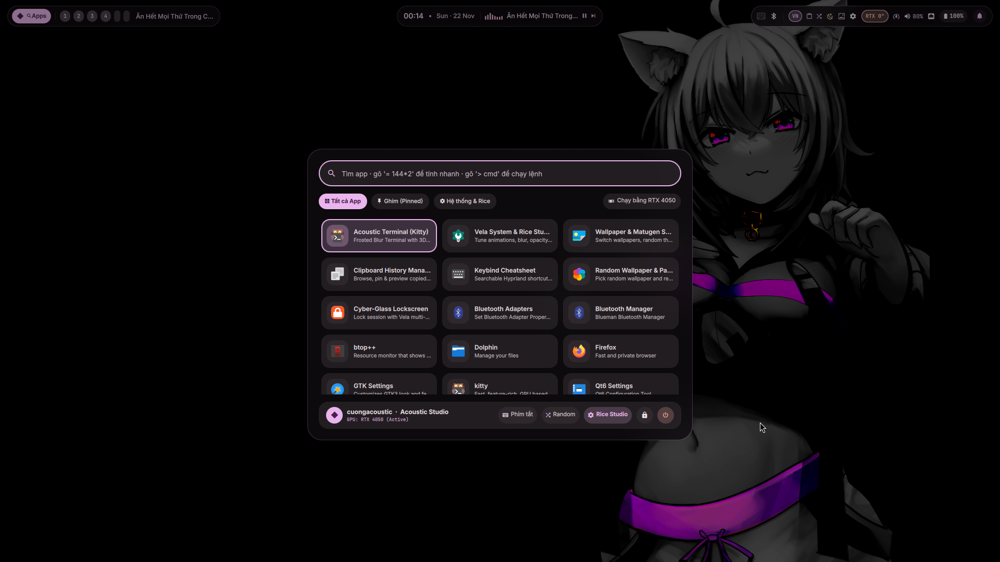
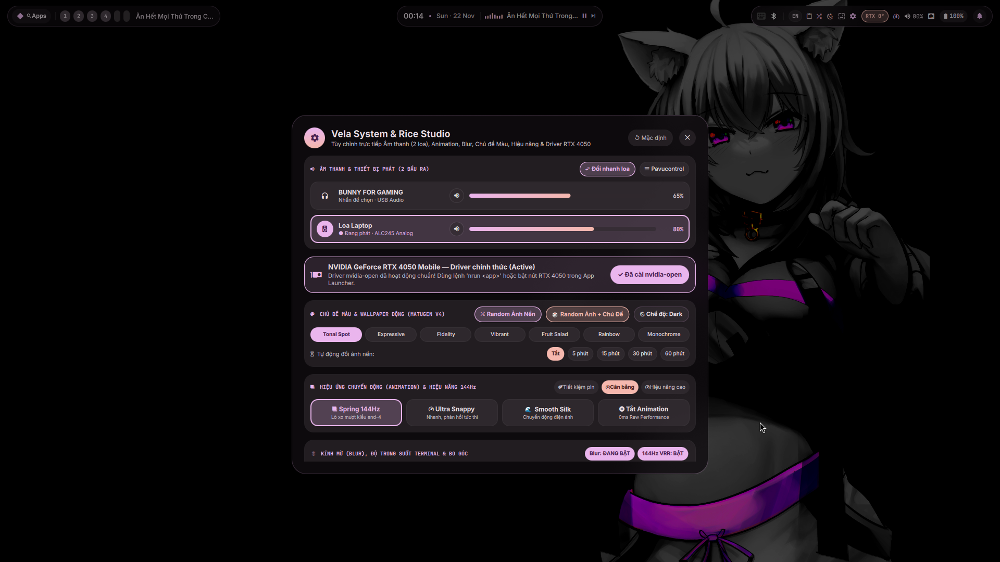
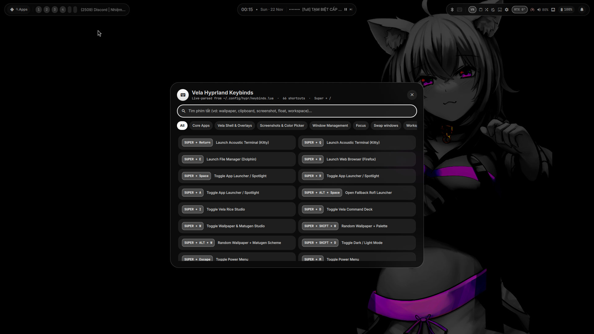

<div align="center">

<br />

# ◆ VELA 2.0 — *Nocturne Prism* ◆

### Obsidian-Glass Material You Desktop for Hyprland (Lua API) & Quickshell

*Tuned for locked 144Hz critically-damped springs, native PipeWire audio mixing, live Cava spectrums, and zero-watt hybrid NVIDIA RTD3 power management on Arch Linux.*

<br />


-58E1FF?style=for-the-badge&logo=hyprland&logoColor=11111B)


<br />

[✨ Features](#-highlights) •
[📸 Showcase](#-showcase) •
[🎨 Dynamic Theming](#-matugen-v4-ecosystem-13-targets) •
[⌨️ Keybindings](#️-keybindings) •
[🚀 Installation](#-installation) •
[⚡ Hybrid GPU](#-hybrid-gpu-optimization)

<br />



<sub><em>Vela 2.0 TopBar (3 Floating Islands · Live Cava Visualizer · System Tray · Fcitx5) + Frosted Obsidian Command Deck</em></sub>

</div>

---

## ✨ Highlights

**Vela 2.0** is a cohesive, pure-Wayland desktop shell written from scratch in **Qt6 QML (Quickshell)** paired with **Hyprland's modern Lua configuration API** — zero Waybar, zero Dunst, zero Eww, zero shell-script polling lag.

- **🏝️ Three-Island Floating TopBar** — Morphing workspace pills, active window title, clock + live **8-bar Cava audio visualizer** & MPRIS media controls, native **System Tray**, clickable **Fcitx5 (`VN`/`EN`)** indicator, hybrid GPU status pill, and unread notification badge.
- **🎛️ Vela Command Deck** — 144Hz tactile sliders (zero-lag drag + fractional touchpad scroll), **native PipeWire Dual-Speaker Switcher & Per-App Audio Mixer**, real-time Ryzen/RTX/RAM telemetry, **12-bar Cava spectrum + MPRIS seek timeline**, and **Notification History Center** with interactive toast actions.
- **🔍 Spotlight 2.0 Launcher** — Real **Papirus-Dark** system icons, frecency ordering, instant **inline calculator** (`= (1920/16)*9` → Enter to copy), **quick shell runner** (`> cmd`), full 3-column arrow-key navigation, and a 1-click **Launch with RTX 4050 (`prime-run`)** toggle.
- **🎨 Vela System & Rice Studio** — Live-tune Hyprland blur size/passes, Kitty terminal opacity, corner rounding, gaps, VRR 144Hz, animation presets (`Spring 144Hz`, `Ultra Snappy`, `Smooth Silk`, `0ms Raw`), **7 Matugen v4 color schemes**, Dark/Light toggle, and **automatic wallpaper slideshow**.
- **📋 Native Clipboard Vault (`Super + V`)** — Pure QML `cliphist` manager with **live image thumbnails**, fuzzy search, pin/unpin favorites, and 1-click delete/wipe.
- **⌨️ Live Keybind Cheatsheet (`Super + /`)** — Dynamically parses `~/.config/hypr/keybinds.lua` into searchable, categorized glass cards.
- **🔐 Cyber-Glass Lockscreen & SDDM** — Matching multi-widget `hyprlock` HUD and `vela-nocturne` SDDM login theme synced automatically with your active wallpaper and Matugen palette.
- **🎸 3D Slanted Chrome Terminal Banner** — Custom QtQuick GPU renderer (`Acoustic.qml`) generating a dynamic Matugen-tinted 3D frosted neon header for Kitty + Fish.

---

## 📸 Showcase

<table>
  <tr>
    <td width="50%" align="center">
      
      <br />
      <strong>Spotlight 2.0 Launcher</strong><br />
      <sub>Real Papirus icons · Inline Calculator · Shell Runner · RTX 4050 Offload</sub>
    </td>
    <td width="50%" align="center">
      
      <br />
      <strong>System & Rice Studio</strong><br />
      <sub>Dual-Speaker Mixer · Matugen Schemes · Slideshow · Live Blur & Springs</sub>
    </td>
  </tr>
  <tr>
    <td width="50%" align="center">
      
      <br />
      <strong>Atmosphere & Wallpaper Studio</strong><br />
      <sub>Radial 144Hz <code>awww</code> Transitions · 7 Material You Schemes · Dark/Light</sub>
    </td>
    <td width="50%" align="center">
      
      <br />
      <strong>Live Keybind Cheatsheet</strong><br />
      <sub>Auto-parsed from <code>keybinds.lua</code> · Search & Category Filters</sub>
    </td>
  </tr>
</table>

---

## 🧱 Tech Stack

| Component | Choice | Notes |
| :--- | :--- | :--- |
| **OS** | Arch Linux | Rolling release, Wayland-native (`uwsm`) |
| **Compositor** | [Hyprland 0.57.2](https://hyprland.org/) | Full **Lua API** (`hyprland.lua` + modular configs) |
| **Desktop Shell** | [Quickshell](https://quickshell.outfoxxed.me/) | 12 custom QML components (Bar, Deck, Launcher, Studio, Clipboard, Cheatsheet, OSD, Toasts, Power) |
| **Dynamic Theming** | [Matugen v4](https://github.com/InioX/matugen) | 13 synchronized templates + Dark/Light + 7 schemes |
| **Wallpaper Engine** | `awww` | 144fps radial grow transitions with custom Bézier |
| **Terminal & Shell** | Kitty + Fish + Starship | Frosted blur, dynamic palette, 3D `Acoustic` banner |
| **Audio & Spectrum** | PipeWire + WirePlumber + Cava | Native QML PipeWire sink/stream bindings + live spectrum |
| **Screenshots & Clip** | `grim` + `slurp` + `satty` + `cliphist` | Native QML Clipboard Vault with image previews |
| **Lock & Login** | `hyprlock` + `hypridle` + SDDM | Matching cyber-glass telemetry HUD & login theme |
| **Typography & Icons** | Inter + JetBrainsMono Nerd Font + Papirus-Dark | Crisp editorial UI + sharp monospace telemetry |

---

## 🎨 Matugen v4 Ecosystem (13 Targets)

Changing your wallpaper (`Super + W`), hitting random (`Super + Shift + W`), or toggling Dark/Light mode (`Super + Shift + D`) regenerates and hot-reloads the entire desktop in under a second:

| Layer | Synchronized Targets |
| :--- | :--- |
| **Desktop & Shell** | Quickshell (`Colors.qml`), Hyprland (`colors.lua`), Hyprlock (`hyprlock-colors.conf`), Rofi (`colors.rasi`) |
| **Toolkits** | GTK 3 (`gtk-3.0/colors.css`), GTK 4 / libadwaita (`gtk-4.0/colors.css`), Qt6ct (`qt6ct/colors/vela.conf`) |
| **Terminal & CLI** | Kitty (`colors.conf`), Fish + FZF (`conf.d/vela-colors.fish`), Starship (`starship.toml`), Yazi (`theme.toml`), btop (`vela.theme`), Cava (`config`) |

---

## ⌨️ Keybindings

> Press <kbd>Super</kbd> + <kbd>/</kbd> at any time to open the interactive searchable cheatsheet.

<details open>
<summary><strong>Vela Shell & Atmosphere</strong></summary>

| Shortcut | Action |
| :--- | :--- |
| <kbd>Super</kbd> + <kbd>Space</kbd> / <kbd>A</kbd> | Toggle **Spotlight 2.0 Launcher** (`=` calc, `>` shell, right-click for RTX 4050) |
| <kbd>Super</kbd> + <kbd>D</kbd> | Toggle **Vela Command Deck** (toggles, PipeWire mixer, telemetry, notifications) |
| <kbd>Super</kbd> + <kbd>I</kbd> | Toggle **Vela System & Rice Studio** |
| <kbd>Super</kbd> + <kbd>W</kbd> | Open **Wallpaper & Matugen Studio** |
| <kbd>Super</kbd> + <kbd>Shift</kbd> + <kbd>W</kbd> | Random Wallpaper + Material You Palette |
| <kbd>Super</kbd> + <kbd>Alt</kbd> + <kbd>W</kbd> | Random Wallpaper + Random Color Scheme |
| <kbd>Super</kbd> + <kbd>Shift</kbd> + <kbd>D</kbd> | Toggle **Dark / Light Mode** across all 13 targets |
| <kbd>Super</kbd> + <kbd>V</kbd> | Open **Native Clipboard Vault** (text + image previews) |
| <kbd>Super</kbd> + <kbd>/</kbd> | Open **Live Keybind Cheatsheet** |
| <kbd>Super</kbd> + <kbd>Alt</kbd> + <kbd>A</kbd> | Cycle Audio Output (Laptop Speaker ↔ USB Headset / Bluetooth) |
| <kbd>Super</kbd> + <kbd>G</kbd> | Toggle **144Hz Game Mode** (disables blur/animations for raw latency) |
| <kbd>Super</kbd> + <kbd>L</kbd> / <kbd>Esc</kbd> | Cyber-Glass Lockscreen / Power Menu |

</details>

<details>
<summary><strong>Core Apps, Window Management & Capture</strong></summary>

| Shortcut | Action |
| :--- | :--- |
| <kbd>Super</kbd> + <kbd>Return</kbd> / <kbd>Q</kbd> | Launch Acoustic Terminal (`kitty`) |
| <kbd>Super</kbd> + <kbd>E</kbd> / <kbd>B</kbd> | Launch Dolphin / Firefox |
| <kbd>Super</kbd> + <kbd>C</kbd> / <kbd>Shift</kbd> + <kbd>Q</kbd> | Close / Force Kill Active Window |
| <kbd>Super</kbd> + <kbd>F</kbd> / <kbd>Shift</kbd> + <kbd>F</kbd> | Fullscreen / Maximize |
| <kbd>Super</kbd> + <kbd>T</kbd> / <kbd>J</kbd> | Toggle Floating / Toggle Dwindle Split |
| <kbd>Super</kbd> + <kbd>S</kbd> / <kbd>Alt</kbd> + <kbd>S</kbd> | Toggle / Send Window to **Prism Scratchpad** |
| <kbd>Super</kbd> + <kbd>1</kbd>..`<0>` | Switch Workspace 1–10 (`Shift` to move window) |
| <kbd>Print</kbd> / <kbd>Super</kbd> + <kbd>Shift</kbd> + <kbd>S</kbd> | Region Screenshot & Annotate (`grim` + `slurp` + `satty`) |
| <kbd>Super</kbd> + <kbd>Shift</kbd> + <kbd>C</kbd> | Color Picker (`hyprpicker -a`) |

</details>

---

## 🚀 Installation

### Quick Install (Arch Linux)

```bash
git clone https://github.com/gbetokuon-stack/vela-dotfiles.git ~/vela-dotfiles
cd ~/vela-dotfiles

# Option A: Install all Arch dependencies + deploy configs (backs up existing ~/.config automatically)
./install.sh --with-packages

# Option B: Deploy configs only (if dependencies are already installed)
./install.sh
```

> **Note:** Existing configurations are automatically backed up to `~/.config-backup-vela-<timestamp>/` before any files are written. Drop your favorite wallpapers into `~/Pictures/Wallpapers/`, then press <kbd>Super</kbd> + <kbd>W</kbd>!

### Syncing Live Changes Back to Git

After tweaking your rice in `~/.config` or `~/.local/bin/vela-*`, pull all live changes cleanly into the repo (with private caches stripped and `$HOME` normalized):

```bash
cd ~/vela-dotfiles
./sync.sh
git add -A && git commit -m "chore: update Vela rice" && git push
```

---

## ⚡ Hybrid GPU Optimization

Built and battle-tested on an **HP Victus 15 (`Ryzen 7 7445HS + Radeon 740M iGPU + NVIDIA RTX 4050 Mobile`)**:

- **Compositor on AMD iGPU (`144Hz` locked)** — `AQ_DRM_DEVICES` routes Hyprland through the AMD iGPU using colon-free symlinks while keeping fullscreen-only VRR (`vrr = 2`) for zero desktop animation stutter.
- **0W RTD3 D3cold Idle** — `scripts/setup-victus-drivers-and-rice.sh` configures `nvidia-open`, udev runtime PM, and UKI/GRUB early KMS so the RTX 4050 sleeps at 0W on battery.
- **RTD3-Safe Telemetry** — `vela-telemetry` checks PCI `runtime_status` before invoking `nvidia-smi`, preventing accidental GPU wakeups.
- **1-Click Offload** — Launch any game or GPU app via `nrun <app>` (`prime-run`) or toggle **"Chạy bằng RTX 4050"** directly inside Spotlight 2.0.

---

## 📂 Repository Structure

```text
vela-dotfiles/
├── assets/                 # Live 1920x1080 Hyprland showcase screenshots
├── bin/                    # Vela CLI & backend helpers (vela-theme, vela-ctl, vela-apps,
│                           #   vela-telemetry, vela-cava, vela-clipboard, vela-keybinds, ...)
├── config/
│   ├── hypr/               # Modular Hyprland 0.57.2 Lua config + hyprlock + hypridle
│   ├── quickshell/vela/    # Complete Vela 2.0 Quickshell desktop shell (12 QML modules)
│   ├── matugen/            # Matugen v4 config + 13 Material You templates
│   ├── kitty/              # Frosted blur terminal config
│   ├── fish/               # Fish shell + dynamic FZF/syntax colors
│   ├── qt6ct/              # Qt6ct Fusion + Matugen color scheme
│   ├── yazi/               # Yazi dynamic theme
│   ├── btop/               # btop dynamic theme
│   ├── cava/               # Cava spectrum config
│   ├── fastfetch/          # Minimalist system fetch
│   ├── rofi/               # Fallback Rofi glass theme
│   ├── vela/banner/        # QtQuick 3D slanted chrome "Acoustic" renderer
│   └── starship.toml       # Dynamic Starship prompt
├── sddm/vela-nocturne/     # Matching Cyber-Glass SDDM login theme
├── scripts/                # Full AMD + NVIDIA Open driver & rice provisioner
├── install.sh              # Automated backup + installer
└── sync.sh                 # Live-to-repo sync utility
```

---

<div align="center">

### Made with ◆ by **cuongacoustic** ([@gbetokuon-stack](https://github.com/gbetokuon-stack))

If **Vela 2.0** inspired your setup, consider giving this repo a ⭐!

</div>
