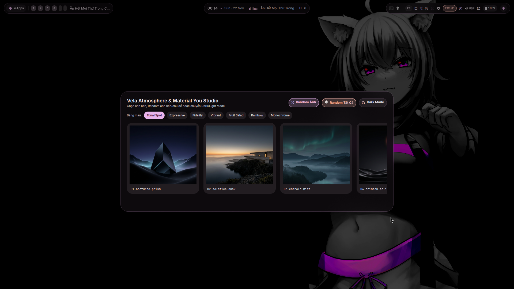

<div align="center">

<br />

# ◆ VELA 2.0 — *Nocturne Prism* ◆

### Obsidian-Glass Material You Desktop for Hyprland (Lua API) & Quickshell

*Tuned for locked 144Hz critically-damped springs, native PipeWire audio mixing, live Cava spectrums, and zero-watt hybrid NVIDIA RTD3 power management on Arch Linux.*

<br />


-58E1FF?style=for-the-badge&logo=hyprland&logoColor=11111B)


<br />

[✨ Highlights](#highlights) •
[📸 Showcase](#showcase) •
[🧰 Requirements](#requirements) •
[🎨 Theming](#theming) •
[⌨️ Keybindings](#keybindings) •
[🚀 Installation](#installation) •
[⚡ Hybrid GPU](#hybrid-gpu) •
[❓ FAQ](#faq)

<br />


<sub><em>Vela 2.0 TopBar (3 Floating Islands · Live Cava Visualizer · System Tray · Fcitx5) + Frosted Obsidian Command Deck</em></sub>

</div>

---

## Table of Contents

- [✨ Highlights](#highlights)
- [🆕 What's New](#whats-new)
- [📸 Showcase](#showcase)
- [🧰 Requirements](#requirements)
- [🧱 Tech Stack](#tech-stack)
- [🎨 Matugen v4 Ecosystem (14 Targets)](#theming)
- [⌨️ Keybindings](#keybindings)
- [🧰 CLI Toolbox](#cli-toolbox)
- [🚀 Installation](#installation)
- [⚡ Hybrid GPU Optimization](#hybrid-gpu)
- [📂 Repository Structure](#repository-structure)
- [🩺 Troubleshooting](#troubleshooting)
- [❓ FAQ](#faq)
- [🤝 Contributing](#contributing)
- [🗺️ Roadmap Ideas](#roadmap)
- [📄 License](#license)

---

<a id="highlights"></a>

## ✨ Highlights

**Vela 2.0** is a cohesive, pure-Wayland desktop shell written from scratch in **Qt6 QML (Quickshell)** paired with **Hyprland's modern Lua configuration API** — zero Waybar, zero Dunst, zero Eww, zero shell-script polling lag.

- **✨ 0.57 Eye-Candy Layer** — Matugen-tinted inner **glow**, springy window **wobble**, optional **motion blur**, blur behind **Fcitx5** popups and a subtle vignette shader. All toggleable live from `Super + I` (or `vela-ctl set …`). Games/fullscreen windows opt out of wobble.
- **🛡️ Share-Safe Overlays** — notification, OSD, power, clipboard and cheatsheet layers are excluded from portal screen sharing, while `grim` screenshots still capture them.
- **🧰 Rebuild Recipe** — `packages/arch.txt`, `update.sh` and [TROUBLESHOOTING.md](TROUBLESHOOTING.md) keep the rice reproducible and repairable.
- **🏝️ Three-Island Floating TopBar** — Morphing workspace pills, active window title, clock + live **8-bar Cava audio visualizer** & MPRIS media controls, native **System Tray**, clickable **Fcitx5 (`VN`/`EN`)** indicator, hybrid GPU status pill, and unread notification badge.
- **🎛️ Vela Command Deck** — 144Hz tactile sliders (zero-lag drag + fractional touchpad scroll), **native PipeWire Dual-Speaker Switcher & Per-App Audio Mixer**, real-time Ryzen/RTX/RAM telemetry, **12-bar Cava spectrum + MPRIS seek timeline**, and a **Notification History Center** with interactive toast actions.
- **🔍 Spotlight 2.0 Launcher** — Real **Papirus-Dark** system icons, frecency ordering, instant **inline calculator** (`= (1920/16)*9` → Enter to copy), **quick shell runner** (`> cmd`), full 3-column arrow-key navigation, and a 1-click **Launch with RTX 4050 (`prime-run`)** toggle.
- **🎨 Vela System & Rice Studio** — Live-tune Hyprland blur size/passes, Kitty terminal opacity, corner rounding, gaps, VRR 144Hz, animation presets (`Spring 144Hz`, `Ultra Snappy`, `Smooth Silk`, `0ms Raw`), **7 Matugen v4 color schemes**, Dark/Light toggle, and **automatic wallpaper slideshow**.
- **🧩 Dock Suite** — 6 dock design presets (Prism / macOS / Island / Cyber / Taskbar / Minimal) with live style cycling and visibility controls.
- **📋 Native Clipboard Vault (`Super + V`)** — Pure QML `cliphist` manager with **live image thumbnails**, fuzzy search, pin/unpin favorites, and 1-click delete/wipe.
- **⌨️ Live Keybind Cheatsheet (`Super + /`)** — Dynamically parses `~/.config/hypr/keybinds.lua` into searchable, categorized glass cards — the cheatsheet can never drift from your actual config.
- **🔐 Cyber-Glass Lockscreen & SDDM** — Matching multi-widget `hyprlock` HUD and `vela-nocturne` SDDM login theme synced automatically with your active wallpaper and Matugen palette.
- **🎸 3D Slanted Chrome Terminal Banner** — Custom QtQuick GPU renderer (`Acoustic.qml`) plus a pure-Unicode `vela-banner` fallback generating a dynamic Matugen-tinted 3D frosted neon header for Kitty + Fish.

---

<a id="whats-new"></a>

## 🆕 What's New

Recent work in the rice (newest first):

| Change | Detail |
| :--- | :--- |
| **Async overlays & native palette** | Quickshell overlays now use `LazyLoader` for lower idle cost, `PersistentProperties` for state that survives reloads, a native `ColorQuantizer` palette, and automatic Firefox/Zen `userChrome.css` theming. |
| **Hyprland 0.57 effects** | Adopted the new Lua `hl.config` API for glow, wobble and motion blur, plus Quickshell 0.3 polish. |
| **Cleaner screenshots** | `vela-shot` works around `satty --early-exit` deleting its temp file before the notification server loads it — no more purple/black missing-texture icon. |
| **Lower latency & power** | DRM hardware cursors, low-latency USB/Bluetooth power management, fast sysfs telemetry, and iGPU VA-API/EGL defaults. |
| **Portable tiling engine** | Flexible split engine now resolves paths through `$HOME` instead of a hardcoded username. |

---

<a id="showcase"></a>

## 📸 Showcase

<table>
  <tr>
    <td width="50%" align="center">
      
      <br />
      <strong>Spotlight 2.0 Launcher</strong><br />
      <sub>Real Papirus icons · Inline Calculator · Shell Runner · RTX 4050 Offload</sub>
    </td>
    <td width="50%" align="center">
      
      <br />
      <strong>System & Rice Studio</strong><br />
      <sub>Dual-Speaker Mixer · Matugen Schemes · Slideshow · Live Blur & Springs</sub>
    </td>
  </tr>
  <tr>
    <td width="50%" align="center">
      
      <br />
      <strong>Atmosphere & Wallpaper Studio</strong><br />
      <sub>Radial 144Hz <code>awww</code> Transitions · 7 Material You Schemes · Dark/Light</sub>
    </td>
    <td width="50%" align="center">
      
      <br />
      <strong>Live Keybind Cheatsheet</strong><br />
      <sub>Auto-parsed from <code>keybinds.lua</code> · Search & Category Filters</sub>
    </td>
  </tr>
</table>

---

<a id="requirements"></a>

## 🧰 Requirements

### Software

- **Arch Linux** (rolling release) — the installer is built around `pacman`.
- **Hyprland 0.57+** with the **Lua config API**, launched through `uwsm`.
- **Quickshell 0.3+** (Qt6/QML).
- **Matugen v4**, **awww**, **PipeWire + WirePlumber**, **Cava**.
- Fonts & theme assets: `inter-font`, `ttf-jetbrains-mono-nerd`, `papirus-icon-theme`, `adw-gtk-theme`.

Install everything automatically with:

```bash
./install.sh --with-packages
# or, for the full GPU/driver recipe:
sudo pacman -S --needed $(grep -v '^#' packages/arch.txt)
```

### Hardware (development target)

Built and battle-tested on an **HP Victus 15** — Ryzen 7 7445HS + Radeon 740M iGPU + NVIDIA RTX 4050 Mobile @ 144Hz. It should run on any Wayland-capable machine; the hybrid-GPU and driver-provisioning pieces are specific to AMD iGPU + NVIDIA dGPU laptops. See [Hybrid GPU](#hybrid-gpu).

> **PostgreSQL-free, no cloud services.** The shell talks to local D-Bus/PipeWire/sysfs interfaces only.

---

<a id="tech-stack"></a>

## 🧱 Tech Stack

| Component | Choice | Notes |
| :--- | :--- | :--- |
| **OS** | Arch Linux | Rolling release, Wayland-native (`uwsm`) |
| **Compositor** | [Hyprland 0.57](https://hyprland.org/) | Full **Lua API** (`hyprland.lua` + modular configs) |
| **Desktop Shell** | [Quickshell 0.3](https://quickshell.outfoxxed.me/) | 16 QML files: Bar, Deck, Launcher, Studio, Dock, Clipboard, Cheatsheet, OSD, Toasts, Power, Wallpapers… with async `LazyLoader` overlays, `PersistentProperties` state and a native `ColorQuantizer` palette |
| **Dynamic Theming** | [Matugen v4](https://github.com/InioX/matugen) | 13 templates → 14 synchronized targets + Dark/Light + 7 schemes |
| **Wallpaper Engine** | `awww` | 144fps radial grow transitions with custom Bézier |
| **Terminal & Shell** | Kitty + Fish + Starship | Frosted blur, dynamic palette, 3D `Acoustic` banner |
| **Audio & Spectrum** | PipeWire + WirePlumber + Cava | Native QML PipeWire sink/stream bindings + live spectrum |
| **Screenshots & Clip** | `grim` + `slurp` + `satty` + `cliphist` | Native QML Clipboard Vault with image previews |
| **Lock & Login** | `hyprlock` + `hypridle` + SDDM | Matching cyber-glass telemetry HUD & login theme |
| **Typography & Icons** | Inter + JetBrainsMono Nerd Font + Papirus-Dark | Crisp editorial UI + sharp monospace telemetry |

---

<a id="theming"></a>

## 🎨 Matugen v4 Ecosystem (14 Targets)

Changing your wallpaper (`Super + W`), hitting random (`Super + Shift + W`), or toggling Dark/Light mode (`Super + Shift + D`) regenerates and hot-reloads the entire desktop in under a second. **13 templates** fan out to **14 live targets** (GTK 3 and GTK 4 share one template):

| Layer | Synchronized Targets |
| :--- | :--- |
| **Desktop & Shell** | Quickshell (`Colors.qml`), Hyprland (`colors.lua`), Hyprlock (`hyprlock-colors.conf`), Rofi (`colors.rasi`) |
| **Toolkits** | GTK 3 (`gtk-3.0/colors.css`), GTK 4 / libadwaita (`gtk-4.0/colors.css`), Qt6ct (`qt6ct/colors/vela.conf`) |
| **Terminal & CLI** | Kitty (`colors.conf`), Fish + FZF (`conf.d/vela-colors.fish`), Starship (`starship.toml`), Yazi (`theme.toml`), btop (`vela.theme`), Cava (`config`) |
| **Browser** | Firefox / Zen `userChrome.css` — copied into detected profiles on every theme change (requires `toolkit.legacyUserProfileCustomizations.stylesheets = true`) |

The 7 built-in schemes: `tonal-spot`, `expressive`, `fidelity`, `vibrant`, `fruit-salad`, `rainbow`, `monochrome`.

---

<a id="keybindings"></a>

## ⌨️ Keybindings

> Press <kbd>Super</kbd> + <kbd>/</kbd> at any time to open the interactive searchable cheatsheet. Source of truth: [`config/hypr/keybinds.lua`](config/hypr/keybinds.lua).

<details open>
<summary><strong>Vela Shell & Atmosphere</strong></summary>

| Shortcut | Action |
| :--- | :--- |
| <kbd>Super</kbd> + <kbd>Space</kbd> / <kbd>A</kbd> | Toggle **Spotlight 2.0 Launcher** (`=` calc, `>` shell, right-click for RTX 4050) |
| <kbd>Super</kbd> + <kbd>D</kbd> | Toggle **Vela Command Deck** (toggles, PipeWire mixer, telemetry, notifications) |
| <kbd>Super</kbd> + <kbd>I</kbd> | Toggle **Vela System & Rice Studio** |
| <kbd>Super</kbd> + <kbd>W</kbd> | Open **Wallpaper & Matugen Studio** |
| <kbd>Super</kbd> + <kbd>Shift</kbd> + <kbd>W</kbd> | Random Wallpaper + Material You Palette |
| <kbd>Super</kbd> + <kbd>Alt</kbd> + <kbd>W</kbd> | Random Wallpaper + Random Color Scheme |
| <kbd>Super</kbd> + <kbd>Shift</kbd> + <kbd>D</kbd> | Toggle **Dark / Light Mode** across all 14 targets |
| <kbd>Super</kbd> + <kbd>V</kbd> | Open **Native Clipboard Vault** (text + image previews) |
| <kbd>Super</kbd> + <kbd>/</kbd> | Open **Live Keybind Cheatsheet** |
| <kbd>Super</kbd> + <kbd>Alt</kbd> + <kbd>A</kbd> | Cycle Audio Output (Laptop Speaker ↔ USB Headset / Bluetooth) |
| <kbd>Super</kbd> + <kbd>G</kbd> | Toggle **144Hz Game Mode** (disables blur/animations for raw latency) |
| <kbd>Super</kbd> + <kbd>L</kbd> / <kbd>Esc</kbd> | Cyber-Glass Lockscreen / Power Menu |

</details>

<details>
<summary><strong>Core Apps, Window Management & Capture</strong></summary>

| Shortcut | Action |
| :--- | :--- |
| <kbd>Super</kbd> + <kbd>Return</kbd> / <kbd>Q</kbd> | Launch Acoustic Terminal (`kitty`) |
| <kbd>Super</kbd> + <kbd>E</kbd> / <kbd>B</kbd> | Launch Dolphin / Firefox |
| <kbd>Super</kbd> + <kbd>C</kbd> / <kbd>Shift</kbd> + <kbd>Q</kbd> | Close / Force Kill Active Window |
| <kbd>Super</kbd> + <kbd>F</kbd> / <kbd>Shift</kbd> + <kbd>F</kbd> | Fullscreen / Maximize |
| <kbd>Super</kbd> + <kbd>T</kbd> / <kbd>J</kbd> | Toggle Floating / Toggle Dwindle Split |
| <kbd>Super</kbd> + <kbd>S</kbd> / <kbd>Alt</kbd> + <kbd>S</kbd> | Toggle / Send Window to **Prism Scratchpad** |
| <kbd>Super</kbd> + <kbd>1</kbd>–<kbd>0</kbd> | Switch Workspace 1–10 (<kbd>Shift</kbd> to move window) |
| <kbd>Print</kbd> / <kbd>Super</kbd> + <kbd>Shift</kbd> + <kbd>S</kbd> | Region Screenshot & Annotate (`grim` + `slurp` + `satty`) |
| <kbd>Super</kbd> + <kbd>Shift</kbd> + <kbd>C</kbd> | Color Picker (`hyprpicker -a`) |

</details>

---

<a id="cli-toolbox"></a>

## 🧰 CLI Toolbox

All helpers land in `~/.local/bin/` and are the same scripts shipped in [`bin/`](bin/):

| Command | Purpose |
| :--- | :--- |
| `vela-theme` | Wallpaper + Matugen engine (`--restore`, `--random`, `--random-all`, `--mode`, `--scheme`) |
| `vela-ctl` | Live rice tuner: blur, opacity, rounding, gaps, VRR, animations, glow, wobble, motion blur, dock |
| `vela-apps` | Scan `.desktop` files into a frecency-ranked app index for Spotlight |
| `vela-cava` | Stream 12-bar raw Cava spectrum into Quickshell |
| `vela-clipboard` | Clipboard backend: list / copy / delete / pin / clear (with thumbnails) |
| `vela-clip` | Toggle the clipboard overlay (Rofi fallback when the shell is down) |
| `vela-keybinds` | Parse `keybinds.lua` → JSON for the live cheatsheet |
| `vela-telemetry` | Low-overhead, sysfs-native CPU/GPU/RAM/network JSON (RTD3-safe) |
| `vela-shot` | Region/fullscreen screenshot with `satty` annotate + clipboard copy |
| `vela-gamemode` | Toggle 144Hz raw-latency mode + performance power profile |
| `vela-banner` | Pure-Unicode 3D "Acoustic" terminal banner |
| `vela-login-preview` | Test the SDDM greeter in windowed mode |
| `vela-login-install` | Install the `vela-nocturne` SDDM theme system-wide (asks for sudo) |
| `vela-fix-nvidia` | Repair NVIDIA open-kernel modules, KMS and blacklist after a kernel update |

Examples:

```bash
vela-ctl set blur_size 12
vela-ctl set anim_preset snappy
vela-ctl set motion_blur_enabled true
vela-ctl apply                       # re-apply after a Hyprland reload
vela-theme --random-all              # new wallpaper + new scheme
vela-shot region                     # or: vela-shot full
```

---

<a id="installation"></a>

## 🚀 Installation

### Quick Install (Arch Linux)

```bash
git clone https://github.com/gbetokuon-stack/vela-dotfiles.git ~/vela-dotfiles
cd ~/vela-dotfiles

# Option A: Install all Arch dependencies + deploy configs (backs up existing ~/.config automatically)
./install.sh --with-packages

# Option B: Deploy configs only (if dependencies are already installed)
./install.sh
```

> **Note:** Existing configurations are automatically backed up to `~/.config-backup-vela-<timestamp>/` before any files are written. Drop your favorite wallpapers into `~/Pictures/Wallpapers/`, then press <kbd>Super</kbd> + <kbd>W</kbd>!

### Manual / step-by-step

1. Install dependencies (see [Requirements](#requirements)).
2. Copy configs: `cp -r config/. ~/.config/`
3. Expand the `__HOME__` placeholder in `~/.config/hypr/env.lua`, `autostart.lua` and `~/.config/qt6ct/qt6ct.conf` with your actual home path (`install.sh` does this for you).
4. Copy helpers: `cp bin/vela-* ~/.local/bin/ && chmod +x ~/.local/bin/vela-*`
5. Stage the SDDM theme: `cp -r sddm/vela-nocturne ~/.local/share/sddm/themes/` then `vela-login-install` if you want it system-wide.
6. Log out and select the **Hyprland** session.

### Daily workflow

```bash
./sync.sh     # live ~/.config -> repo (strips caches & private state)
./update.sh   # repo -> live (fetch, backup, install, hyprctl reload)
```

```bash
cd ~/vela-dotfiles
./sync.sh
git add -A && git commit -m "chore: update Vela rice" && git push
```

`update.sh` refuses to run with a dirty working tree or unpushed local commits, so it will never silently clobber your work.

---

<a id="hybrid-gpu"></a>

## ⚡ Hybrid GPU Optimization

Built and battle-tested on an **HP Victus 15 (`Ryzen 7 7445HS + Radeon 740M iGPU + NVIDIA RTX 4050 Mobile`)**:

- **Compositor on AMD iGPU (`144Hz` locked)** — `AQ_DRM_DEVICES` routes Hyprland through the AMD iGPU using colon-free symlinks while keeping fullscreen-only VRR (`vrr = 2`) for zero desktop animation stutter.
- **0W RTD3 D3cold Idle** — `scripts/setup-victus-drivers-and-rice.sh` configures `nvidia-open`, udev runtime PM, and UKI/GRUB early KMS so the RTX 4050 sleeps at 0W on battery.
- **RTD3-Safe Telemetry** — `vela-telemetry` checks PCI `runtime_status` before invoking `nvidia-smi`, preventing accidental GPU wakeups.
- **1-Click Offload** — Launch any game or GPU app via `nrun <app>` (`prime-run`) or toggle **"Chạy bằng RTX 4050"** directly inside Spotlight 2.0.
- **Kernel updates** — after a new kernel, run `vela-fix-nvidia` to rebuild `initramfs` with early KMS and re-blacklist `nouveau`.

---

<a id="repository-structure"></a>

## 📂 Repository Structure

```text
vela-dotfiles/
├── assets/                 # Live 1920x1080 Hyprland showcase screenshots
├── bin/                    # 14 Vela CLI & backend helpers (vela-theme, vela-ctl, vela-apps,
│                           #   vela-telemetry, vela-cava, vela-clipboard, vela-keybinds, ...)
├── config/
│   ├── hypr/               # Modular Hyprland 0.57 Lua config + shaders/vela-vignette.frag + hyprlock + hypridle
│   ├── quickshell/vela/    # Complete Vela 2.0 Quickshell desktop shell (16 QML files)
│   ├── matugen/            # Matugen v4 config + 13 Material You templates
│   ├── kitty/              # Frosted blur terminal config
│   ├── fish/               # Fish shell + dynamic FZF/syntax colors
│   ├── qt6ct/              # Qt6ct Fusion + Matugen color scheme
│   ├── yazi/               # Yazi dynamic theme
│   ├── btop/               # btop dynamic theme
│   ├── cava/               # Cava spectrum config
│   ├── fastfetch/          # Minimalist system fetch
│   ├── rofi/               # Fallback Rofi glass theme
│   ├── vela/banner/        # QtQuick 3D slanted chrome "Acoustic" renderer
│   └── starship.toml       # Dynamic Starship prompt
├── sddm/vela-nocturne/     # Matching Cyber-Glass SDDM login theme
├── scripts/                # Full AMD + NVIDIA Open driver & rice provisioner
├── packages/arch.txt       # Reproducible Arch package list
├── TROUBLESHOOTING.md      # Common fixes (shader, shell, RTD3, sync)
├── install.sh              # Automated backup + installer
├── update.sh               # Fetch -> install -> hyprctl reload
└── sync.sh                 # Live-to-repo sync utility
```

---

<a id="troubleshooting"></a>

## 🩺 Troubleshooting

See the dedicated **[TROUBLESHOOTING.md](TROUBLESHOOTING.md)** for step-by-step fixes covering:

- Hyprland won't start / black screen (Lua config parse errors)
- Vignette / grain shader glitches
- Missing glow / wobble / motion blur after tuning
- Quickshell panels missing or shell crash loops
- NVIDIA dGPU not sleeping (battery drain)
- Config changes "not sticking" after `sync.sh`
- Firefox / Zen chrome not following the wallpaper
- Native Wi-Fi status in the bar (NetworkManager requirement)

---

<a id="faq"></a>

## ❓ FAQ

**Does this work outside Arch Linux?**
The dotfiles themselves are mostly portable, but `install.sh --with-packages`, `packages/arch.txt` and the NVIDIA provisioner are Arch-specific. On other distros, install the equivalent packages manually and use the [manual install](#installation) steps.

**Why no Waybar / Dunst / Eww?**
Everything is drawn by Quickshell in QML, so there is one compositor-facing process instead of several polling scripts — lower latency and a single consistent theme source.

**My existing config got overwritten.**
It shouldn't be: `install.sh` copies anything it touches into `~/.config-backup-vela-<timestamp>/` first. Restore from the newest backup and re-run the installer if needed.

**Screenshot notifications show a purple icon.**
Fixed in `vela-shot` by disabling `satty --early-exit` notifications and using a persistent preview image. Make sure you're running the latest `bin/vela-shot`.

**Can I use SSH to push?**
Not by default — this machine has no `~/.ssh` key. GitHub CLI is authenticated over HTTPS, so `origin` uses `https://`. To switch to SSH, generate a key, add it to your GitHub account, then `git remote set-url origin git@github.com:gbetokuon-stack/vela-dotfiles.git`.

**Can I use this on a desktop without a dGPU?**
Yes. The shell, theming and keybinds are GPU-agnostic; just skip the hybrid-GPU scripts and the `prime-run` launcher option.

---

<a id="contributing"></a>

## 🤝 Contributing

Contributions are welcome — especially new QML widgets, Matugen templates and hardware-specific fixes.

```bash
fork / clone
git checkout -b feat/my-change
# edit configs in ~/.config, then: ./sync.sh
git add -A && git commit -m "feat: my change"
git push origin feat/my-change
# open a Pull Request
```

Guidelines:

- Keep machine-specific paths as `__HOME__` in tracked files — `sync.sh` normalizes `$HOME` automatically.
- Never commit private state (`fish_variables`, `~/.config/hypr/dri/`, `*.orig`, wallpaper caches) — `.gitignore` already covers these.
- Test a Hyprland reload (`hyprctl reload`) and a Quickshell restart before submitting.
- Update [TROUBLESHOOTING.md](TROUBLESHOOTING.md) when you introduce a new debugging step.

---

<a id="roadmap"></a>

## 🗺️ Roadmap Ideas

Not promises — just a few directions the rice could take next:

- Native NetworkManager status widget once the machine moves back to NM.
- Configurable accent presets beyond Matugen's 7 schemes.
- A `vela-doctor` command that runs the TROUBLESHOOTING checklist automatically.
- Wayland-native screen-record helper integrated into the Command Deck.
- Optional Hyprland fallback docs for non-Arch distributions.

---

<a id="license"></a>

## 📄 License

Distributed under the **MIT License** — see [LICENSE](LICENSE) for details.

---

<div align="center">

### Made with ◆ by **cuongacoustic** ([@gbetokuon-stack](https://github.com/gbetokuon-stack))

If **Vela 2.0** inspired your setup, consider giving this repo a ⭐!

</div>
